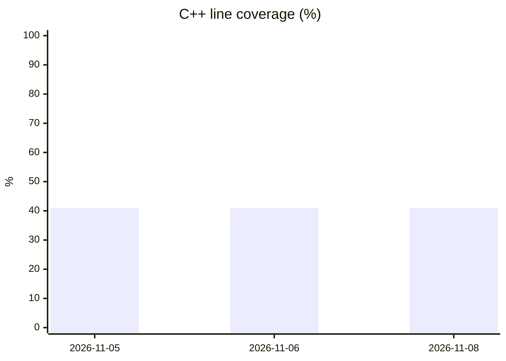
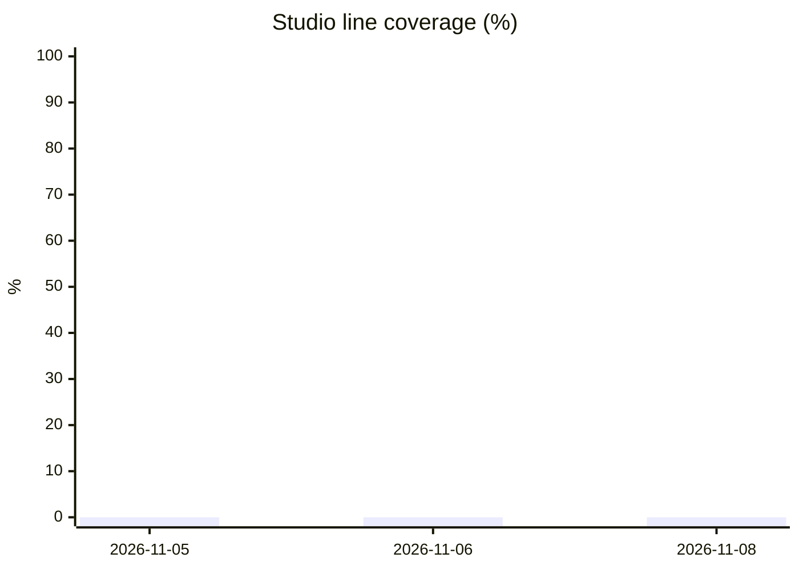
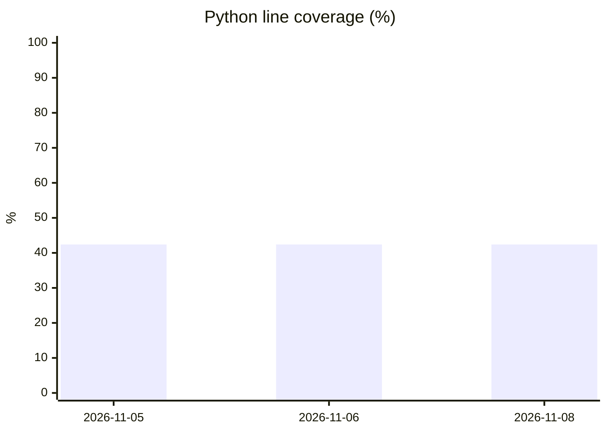

# ShapeWorks test coverage

Updated weekly by the [Linux Coverage](https://github.com/SCIInstitute/ShapeWorks/actions/workflows/coverage.yml) workflow. Raw data is in [history.csv](history.csv); full HTML reports are attached to each workflow run.

Latest: 2026-11-08, commit [015365d365](https://github.com/SCIInstitute/ShapeWorks/commit/015365d3658eab9ea3c37cb4caf651c4ce63b850)

| | Coverage |
|---|---|
| C++ lines | 41.0% |
| C++ functions | 47.6% |
| C++ branches | 37.1% |
| Studio lines | 0.0% |
| Python lines | 42.4% |

## Recent runs

| Date | Commit | C++ lines | C++ functions | C++ branches | Studio lines | Python lines | Run |
|---|---|---|---|---|---|---|---|
| 2026-11-08 | [015365d365](https://github.com/SCIInstitute/ShapeWorks/commit/015365d3658eab9ea3c37cb4caf651c4ce63b850) | 41.0 | 47.6 | 37.1 | 0.0 | 42.4 | [run](https://github.com/SCIInstitute/ShapeWorks/actions/runs/42482091130) |
| 2026-11-06 | [015365d365](https://github.com/SCIInstitute/ShapeWorks/commit/015365d3658eab9ea3c37cb4caf651c4ce63b850) | 41.0 | 47.6 | 37.1 | 0.0 | 42.4 | [run](https://github.com/SCIInstitute/ShapeWorks/actions/runs/42099879708) |
| 2026-11-05 | [2606b12c19](https://github.com/SCIInstitute/ShapeWorks/commit/2606b12c193019bb0af14323004d43b854da1277) | 41.0 | 47.6 | 37.1 | 0.0 | 42.4 | [run](https://github.com/SCIInstitute/ShapeWorks/actions/runs/42051801372) |
